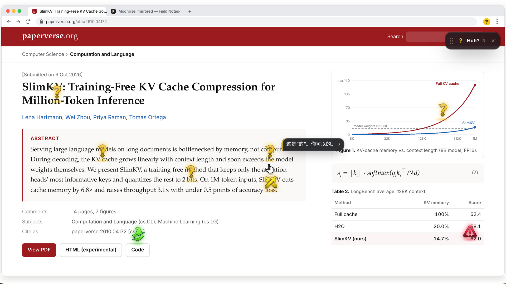

# Huh? Ping (Chrome extension, v0.11.5)

A LoL-style ping wheel for the whole web.

▶ [Watch the demo video (中文, 37 s)](media/huh-ping-demo-zh.mp4)

Free and non-commercial. Not affiliated with Riot Games (see [Credits & notice](#credits--notice)).

- Hold Alt or G and click: drops a ? on that exact spot. AI explains the word, sentence or paragraph under the cursor; when you click an image or chart, it also sends a cropped screenshot with the spot circled.
- Hold Alt or G and hold or drag: opens the 5-slice wheel (! wrong, ⚔ keep going, 👍 got it, ✓ push & merge, ? huh).
- Ping ? again on an answer card to get it said more simply. ⚔ on a card continues that answer; anywhere else it types "继续" into the page's chat box (ChatGPT / Claude / DeepSeek…) and sends it.
- Spam lock: 6 pings in 5 s locks pinging for 6/12/16/20/24 s.

## Install
1. Unzip.
2. Open chrome://extensions and turn on Developer mode.
3. Click "Load unpacked" and pick the unzipped folder.
4. Click the extension icon to open settings. Fill in the API base URL, key and model (any OpenAI-compatible endpoint).

## Setup in 30 seconds
1. chrome://extensions → Developer mode → Load unpacked → pick this folder. The settings page opens by itself.
2. Subscriptions: double-click `bridge/启动小桥.command` (Mac; first time right-click → Open) or `bridge/启动小桥.bat` (Windows). Needs Node.js 18+. The settings page finds it and adds every agent CLI you're signed in to. No token to copy: the bridge pairs with the first extension that calls it (`node huh-bridge.mjs --reset` to pair again).
3. Or paste an API key: the provider is recognised from the key (sk-or- OpenRouter, xai- Grok, AIza Gemini, gsk_ Groq, zhipu id.secret; plain sk- keys are probed against DeepSeek, OpenAI, Kimi, 通义, 硅基流动) and its models are fetched.
Everything saves automatically.

## Many accounts, many models
Settings → 接入的账号和模型: add as many connections as you like, side by side:
- API key (OpenAI-compatible): OpenAI, DeepSeek, xAI Grok, OpenRouter, Kimi, 通义, 智谱, Ollama, or a custom URL. 拉取模型 reads the provider's /models list.
- Subscriptions through the local bridge: Codex (ChatGPT), Claude Code (Claude), Gemini CLI, Cursor CLI (Cursor), CodeBuddy (WorkBuddy), pi. Models are passed with -m / --model; leave blank to use the CLI's own default.
Pick a default model. Each answer card has a model chip (top right): pick another model and the same question is asked again with it.
API keys stay in the extension's storage and are never sent to the page.
Devin has no local CLI to drive, so it isn't supported.

## Use your subscriptions (Codex / Claude Code / Gemini CLI / pi / Cursor / CodeBuddy)
The local bridge runs the agent CLIs you are already signed in to, so ? and ! are answered on your own plan and ⚔ / ✓ continue your real terminal session.
1. Install and sign in to any of them: `codex`, `claude`, `gemini`, `pi`.
2. Double-click `bridge/启动小桥.command` / `.bat`, or run `node bridge/huh-bridge.mjs` from a terminal (Node 18+).
3. The settings page connects by itself and adds the agents it finds. Advanced settings: the terminal agent for 继续 / Push & Merge and the project folder.

What each ping runs:
| | ? / ! (read-only) | ⚔ keep going | ✓ push & merge |
|---|---|---|---|
| Codex | `codex exec --sandbox read-only --ephemeral` | `codex exec resume --last` (workspace-write) | same, plus network for git push |
| Claude Code | `claude -p` (Read only) | `claude -p --continue --permission-mode acceptEdits` | `claude -p --continue --allowedTools "Bash(git *),Bash(gh *),Read,Edit"` |
| Gemini CLI | `gemini -p` | `gemini -r latest -p --approval-mode auto_edit` | `--approval-mode yolo` |
| pi | `pi -p --no-session` | `pi -c -p` | `pi -c -p` |
| Cursor | `cursor-agent -p --mode ask` | `cursor-agent -p --continue --force` | same |
| CodeBuddy (WorkBuddy) | `codebuddy -p` | `codebuddy -c -p` | same |

The bridge listens on 127.0.0.1 only, refuses web-page origins, and only accepts the extensions it paired with (stored in ~/.huh-bridge.json) plus the unpacked extension in its own folder (it computes that folder's extension ID the way Chrome does). Another copy of the extension that asks is refused until you type `y` in the bridge window (`node huh-bridge.mjs --reset` forgets all pairings).
Note: ⚔ and ✓ resume the most recent session in the project folder as a new headless turn. They don't type into a TUI window you already have open.
Note: Google moved free and Google One users from Gemini CLI to Antigravity CLI on June 18, 2026.

## Credits & notice
- The ping wheel art and sound effects in `assets/` (`*_art.webp`, `*_sound.mp3`) come from League of Legends, via [darrenprx/lolPing](https://github.com/darrenprx/lolPing) and [enemiesaremissing.com](https://enemiesaremissing.com). They are owned by Riot Games.
- Huh? Ping was created under Riot Games' "Legal Jibber Jabber" policy using assets owned by Riot Games. Riot Games does not endorse or sponsor this project.
- Huh? Ping is free and non-commercial. It is not sold, has no paid tier, and carries no ads.
- The PDF reader uses [pdf.js](https://github.com/mozilla/pdf.js) (Apache-2.0, see `lib/PDFJS-LICENSE`).

## License
The code in this repository is MIT licensed (see `LICENSE`). The MIT license covers the code only: the League of Legends art and sound effects in `assets/` are excluded and belong to Riot Games; pdf.js in `lib/` keeps its own Apache-2.0 license.

## v0.8 — 解释做到无敌
- 一句话气泡：回答第一句直接冒在问号旁边，点气泡展开完整卡片（设置里可关）。
- 更准：带上页面标题、所在小节标题、页面简介，自动认出代码 / 公式 / 报错 / 按钮 / 表格 / 图片视频 / 外文，用对应的讲法。
- 回答结构：第一句就是答案，后面最多三行（含义、为什么、例子或比喻）。
- 生词可点：回答里虚线下划线的词，点一下就在同一张卡里解释它。
- 「还是不懂」三级：说简单点 → 换个比喻 → 一步步举例。

## v0.9 — 场景预设包
回答下面的快捷按钮会跟着你点的东西自动换：
- 📄 论文（arXiv、OpenReview、知网等论文页，或点到公式）：讲人话 / 翻译 / 方法拆解 / 新在哪 / 局限
- 🔤 英语：翻译 / 生词语法 / 语气 / 怎么回 / 怎么读
- 🖼 图片：这是什么 / 风格手法 / 生成提示词 / 图中文字
- 🎬 视频：这一帧 / 怎么做的 / 生成提示词
- ⌨ 代码：逐行解释 / 有 bug 吗 / 怎么用 / 改简洁
- ⚠ 报错：怎么修 / 为什么
- 🛡 按钮：安全吗 / 点了会怎样
- 📊 数据：说明什么 / 有误导吗
- 其余用「通用」。设置 → 预设里可以用 [论文] 这样的标题改任意一组。

## v0.10 — 反推提示词 + 补坑
- 图片问号直接读原图（最长边 1280px），不再用屏幕截图的一角；图片组的「反推提示词」一次给 Midjourney / Flux·SD / Nano Banana / 反向提示词 / 关键参数，代码块一键复制。视频组可以反推 Kling / Veo / Sora 的提示词。
- 隐私名单：邮箱、银行、支付、密码管理器默认先问一句再发；可以「这次发送」或「这个网站以后都发」。设置里可改，`*` 通配，`!` 放行。
- 历史：每次回答都存在本机（最多 100 条），侧边栏 🕘 打开；同一页面点开能接着问，别的页面点了会打开那个页面。
- 第一次用会提示「按住 Alt / Option 点一下」。
- Mac 上 Option+点击链接不会再触发下载。
- 回答没把握时会直说「不太确定」；通用组多了「出处」。

## v0.11 — iframe 和 PDF 也能打问号
- iframe（嵌入的文档、评论区、视频播放器、在线编辑器预览……）里按 Alt 点一下，问号和回答会出现在外层页面的侧边栏里，截图也会自动对准位置。
- PDF：Chrome 自带的 PDF 阅读器不让任何插件进去，所以打开 PDF 时会自动换成 Huh? 阅读器（基于 pdf.js，支持选字、缩放、Ctrl +/-/0）。论文 PDF 会自动用「论文」预设。顶部「原阅读器」可以切回 Chrome 自带的。设置里可以关掉。
- 本地 PDF：直接拖进阅读器，或者在 chrome://extensions 里给 Huh? Ping 打开「允许访问文件网址」。

## v0.11.1 — 模型列表自己拉
- 新版小桥（v3）启动时，如果旧小桥还占着端口，会自动把它关掉再接手。
- 模型菜单会说清楚为什么没列出来：小桥没开、小桥是旧版，或者 CLI 没给出列表。
- Codex 在 `codex debug models` 不可用时，会读 ~/.codex 里的模型缓存和 config.toml。
- 没装的 CLI 不再出现在菜单里。
- 搜索框里输入任意模型名都能直接用，用过一次就会记住。

## v0.11.2 — 侧边栏两个修复
- 收起的侧边栏（小条）不会再每打一个问号就重新滑进来一次；已经展开的卡片也不会每次都重新淡入。原因：每次打问号时为了看到下面的网页，整个插件界面被临时 `display:none` 了一下，这会让里面所有动画从头播放。现在改成临时隐身（visibility），动画不受影响。
- 卡片多了以后，最底下那张卡（接着问输入框、按钮）一定能滚到、点到：左边 / 右边、拖宽拖窄、窗口很矮、页面有横向滚动条时都一样。
  - 点一下收起的小条把它打开时，侧边栏不会再跳到左边、变成小条那么窄（以前点一下会被当成拖动，把小条的宽度存成了侧边栏的宽度）。拖动小条也不会改掉你调好的宽度。
  - 侧边栏的高度按真正看得见的窗口高度算（扣掉页面横向滚动条），标题栏不会被挤扁，卡片不会被压缩。

## v0.11.3 — 设置页直接点选模型
- 「已接入」里每个订阅（Claude Code、Codex、Cursor、Gemini CLI……）下面直接列出它能用的模型，点一下选上 / 再点取消，不用再手打模型名。「默认模型」永远是第一个。列表和回答卡片上的模型菜单是同一个来源（小桥的模型列表）。
- 模型多的（Cursor、Codex、API key）先显示最常用的 8 个，点「更多 (N)」展开，展开后可以搜。实在没有的，点小字「没找到？手动输入」。
- 小桥没开、小桥是旧版、或者 CLI 没给出列表时，那一行会直接写明原因；上次拉到的列表会先留着。
- 列表存在本机，再打开设置页立刻就有，后台再悄悄刷新。
- 「默认用哪个模型回答」现在按账号分组列出所有模型；在这里选的模型也会自动加进那个账号。

## v0.11.5
- 更快：DeepSeek 接入后默认用 deepseek-flash（能看图）并关掉思考模式，首字约 1 秒；Codex 订阅提问改用低推理强度。小桥 v5。

## v0.11.4 — Windows 上模型列表全都拉不到的修复（小桥 v4）
- 修好：Windows 上设置页每个订阅都显示「模型列表没拉到」、只有「默认模型」。主要原因是小桥认插件：小桥只认第一次配对的那个插件 ID，而「加载已解压的扩展程序」时插件 ID 是按文件夹路径算的，把新版解压到新文件夹就是另一个 ID。小桥的 /health 不检查配对（所以一直显示「已连上」），但列模型、回答都会被拒（403），设置页又把这个错误吞掉了，只说「没拉到」。
  - 新版小桥认得出和它在同一个插件文件夹里的插件，直接放行，并记住；以前配对过的也继续认。
  - 如果小桥不在这个插件的文件夹里（比如还开着旧文件夹的小桥），设置页顶上会写「已连上，但小桥配对的是另一个 Huh? Ping」，告诉你怎么办；在小桥窗口里输入 y 回车也能放行。回答卡片也会说同样的话，不再是一串 403。
- Windows 上启动 CLI 更稳：不再用 `where`（中文用户名路径会乱码），自己按 PATH / PATHEXT 找；npm 的 .cmd 壳直接用 node 跑它的 JS；Cursor 的 cursor-agent.cmd → .ps1 → versions\最新版\index.js 也直接跑起来（以前会因为 Node 不允许直接启动 .cmd 而失败，问 Cursor 还可能把小桥整个弄崩）。任何启动失败都只算这一次请求失败，小桥不会退出。
- 模型列表永远有东西可点：CLI 给出的实时列表优先；拿不到时用 Codex 的本地缓存，或内置的当前模型清单，并在那一行用灰色小字写「列表来自内置清单（实时获取失败：具体原因）」。只有真的什么都没有时才用橙色提示。去掉了设置页上「在搜索框里输入」这句（设置页没有搜索框）。
- 输出解析不怕 Windows 的换行（CRLF）和颜色码；Cursor 的 `auto` 也会列出来；超时放宽到 20 秒。
- Claude Code 加上 fable / opusplan 和完整型号名；Gemini CLI 加上 gemini-3.1-pro-preview、gemini-3.5-flash 等型号名。
- 更新方法：关掉原来的小桥窗口（不关也行，新版会把旧版关掉再接手），在新的插件文件夹里双击 `bridge\启动小桥.bat`，然后在 chrome://extensions 里重新加载插件。

